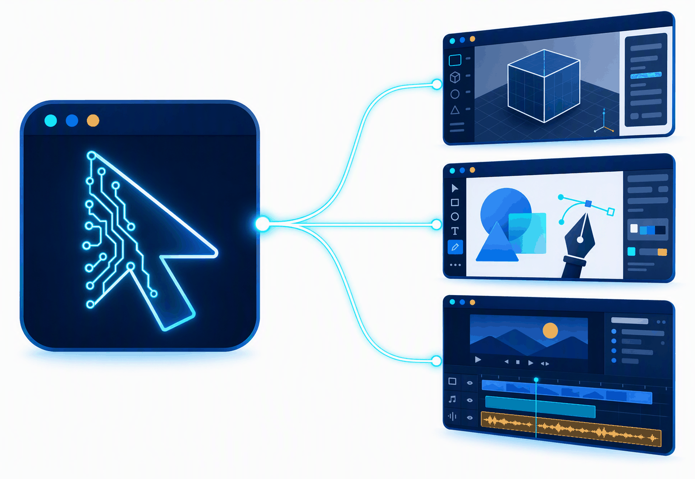

<div align="center">
  
  <h1>WindowsComputerUseMCP</h1>
  <p><strong>AI エージェントが Windows のデスクトップアプリを「見て・考えて・操作する」ための MCP サーバー</strong></p>
</div>

<p align="center">
  
</p>

GitHub Copilot などの MCP (Model Context Protocol) クライアントから、Windows 上の**任意のデスクトップアプリケーション**を
人間と同じ手段（画面認識・マウス・キーボード・UI Automation）で操作するためのローカル MCP サーバーです。
特定アプリ専用のコードは持たず、汎用的な「Computer Use」ツール群として実装しています。

最終目標は、Clipchamp の動画編集、Blender の 3D 操作、Adobe 製品の操作など、UI Automation だけでは
完結しない複雑なアプリケーションも、`screen_capture` + 座標操作 + 画面差分検出を組み合わせて
人間のように自在に操作できるようにすることです（詳細は [ROADMAP.md](ROADMAP.md) を参照）。

> **ライセンス**: 個人利用・非商用利用は無償です。商用利用には別途ライセンス契約が必要です。
> 詳細は [LICENSE.md](LICENSE.md) を参照してください。

## 構成

| プロジェクト | 役割 |
|---|---|
| `WindowsComputerUseMCP.Core` | MCP/Windows実装に依存しない共通モデル・インターフェース・設定 |
| `WindowsComputerUseMCP.Safety` | 緊急停止・安全ポリシー（危険操作の承認要求・拒否判定） |
| `WindowsComputerUseMCP.Windows` | Win32 P/Invoke・UI Automation (FlaUI)・SendInput の実装 |
| `WindowsComputerUseMCP.Skills` | アプリ別「スキルパック」フレームワーク（Blender専用APIブリッジ、Adobe/Clipchamp向け汎用UIA操作など） |
| `WindowsComputerUseMCP.Server` | MCP stdio サーバー本体（ツール登録・DI・ホスティング） |
| `WindowsComputerUseMCP.ControlPanel` | 常時状態確認・緊急停止操作・監査ログ閲覧用の WPF アプリ |
| `WindowsComputerUseMCP.Tests` | 単体テスト |

詳細な設計は [ARCHITECTURE.md](ARCHITECTURE.md)、安全設計は [SECURITY.md](SECURITY.md) を参照してください。

## 必要環境

- Windows 10/11
- **.NET 10 SDK**
- Visual Studio 2022 (17.14+) または VS Code + GitHub Copilot 拡張機能（MCP クライアントとして利用する場合）

## ビルド・テスト

```powershell
dotnet build
dotnet test
```

## MCP クライアントへの登録方法（VS Code / GitHub Copilot）

ビルド後、`src\WindowsComputerUseMCP.Server\bin\Debug\net10.0-windows\WindowsComputerUseMCP.Server.exe` が
stdio ベースの MCP サーバーとして起動できます。

### ワークスペース単位で登録する場合

プロジェクト直下（または任意のワークスペース）に `.vscode/mcp.json` を作成します。

```json
{
  "servers": {
    "windows-computer-use": {
      "type": "stdio",
      "command": "C:\\path\\to\\WindowsComputerUseMCP\\src\\WindowsComputerUseMCP.Server\\bin\\Debug\\net10.0-windows\\WindowsComputerUseMCP.Server.exe"
    }
  }
}
```

### ユーザープロファイル単位で登録する場合

コマンドパレットから **MCP: Open User Configuration** を実行し、同様の `servers` エントリを追加します。
全ワークスペースで共通のサーバーを使いたい場合はこちらを利用してください。

登録後、VS Code の Chat ビューでツールの利用を許可すると、`window_list` や `screen_capture` などの
ツールがエージェントから呼び出せるようになります。

> **注意**: 本サーバーはローカルマシンのマウス・キーボード・画面を直接操作します。信頼できるプロンプト・
> エージェントからのみ利用し、[SECURITY.md](SECURITY.md) の安全設計（緊急停止・承認要求・監査ログ）を
> 必ず確認してください。

## 提供する MCP ツール

| ツール名 | 概要 |
|---|---|
| `system_get_capabilities` | OSバージョンやサーバーの機能可否を取得（読み取り専用） |
| `window_list` | 開いているウィンドウの一覧を取得 |
| `window_focus` | 指定したウィンドウを前面化 |
| `screen_capture` | 画面全体または指定ウィンドウのスクリーンショットを取得 |
| `ui_get_tree` | UI Automation ツリーを取得 |
| `ui_find` | 条件に一致する UI 要素を検索 |
| `ui_invoke` | UI 要素に対して Invoke/Toggle 等のパターン操作を実行 |
| `mouse_move` / `mouse_click` / `mouse_drag` / `mouse_scroll` | 座標ベースのマウス操作 |
| `keyboard_type_text` / `keyboard_press` / `keyboard_hotkey` | キーボード入力操作 |
| `wait_for_screen_change` | 操作前後の画面差分を検出し、変化を待機・確認 |
| `background_desktop_*` | ユーザーの画面に映らない「隠しデスクトップ」上でアプリを起動・操作（後述） |

すべての入力系ツールは Safety 層のポリシー判定（許可アプリ／危険操作の承認要求／緊急停止）を経由します。

## フォアグラウンド操作とバックグラウンド操作

「AIが操作している間、自分のPCが使えなくなるのでは？」という点は本MCPの重要な論点です。
実際には、**操作の種類によってフォアグラウンドが必要かどうかが異なります**。

### 1. もともとバックグラウンドで完結するもの（画面を奪わない）

| 手段 | 対象 | 理由 |
|---|---|---|
| スキルパックのAPIブリッジ | Blender（TCP 9876）、Illustrator（COM `DoJavaScript`）、Figma（WebSocket 9877） | アプリの公式スクリプティングAPIを直接叩くため、画面操作を一切伴わない |
| `ui_invoke` | UI Automation に対応したアプリ全般 | InvokePattern 等はメッセージベースで、前面化やフォーカスを必要としない |
| `screen_capture`（`windowHandle` 指定） | ほぼすべてのウィンドウ | `PrintWindow` + `PW_RENDERFULLCONTENT` により、背面や一部隠れたウィンドウも描画内容を取得できる |

つまり **「見る」と「APIで動かす」はすでにバックグラウンドで可能** です。

### 2. フォアグラウンドが必要なもの

`mouse_move` / `mouse_click` / `mouse_drag` / `mouse_scroll` / `keyboard_*` は
Win32 の `SendInput` を使用します。`SendInput` は**入力デスクトップ（＝ユーザーが実際に見ている画面）
のハードウェア入力キューに注入する**API であるため、対象ウィンドウが前面にある必要があります。

### 3. 「サブモニター（スクリーン2）でやらせる」では解決しない理由

Windows では、複数モニターを繋いでいても **1セッション＝1デスクトップ＝1つのカーソル・1つのフォーカス・
1つの入力キュー**です。モニターは同じデスクトップの表示領域が広がるだけなので、
サブモニターにウィンドウを置いてもマウスカーソルとフォーカスは共有されたままです。分離するには、

1. **同一セッション内の別デスクトップオブジェクト**（本MCPが採用）
2. 別の Windows セッション（RDP・ユーザー切り替え）
3. VM / Windows Sandbox

のいずれかが必要です。

### 4. `background_desktop_*` ツール（隠しデスクトップ方式）

Win32 の `CreateDesktopW` で**画面に表示されないデスクトップオブジェクト**を作り、
専用ワーカースレッドを `SetThreadDesktop` でそこに束縛して操作します。
アプリは `STARTUPINFO.lpDesktop` 指定で最初からその隠しデスクトップ上に起動されるため、
**ユーザーが見ている画面には一切現れません**。

| ツール名 | 概要 |
|---|---|
| `background_desktop_create` | 隠しデスクトップを作成 |
| `background_desktop_list` | 隠しデスクトップと、その上のウィンドウ数を一覧 |
| `background_desktop_launch` | 隠しデスクトップ上でアプリを起動 |
| `background_desktop_window_list` | 隠しデスクトップ上のウィンドウを列挙（通常の `window_list` では見えない） |
| `background_desktop_capture` | 隠しデスクトップ上のウィンドウをキャプチャ |
| `background_desktop_click` | 隠しデスクトップ上でクリック |
| `background_desktop_type_text` | 隠しデスクトップ上でテキスト入力 |
| `background_desktop_send_keys` | 隠しデスクトップ上でキー送信 |
| `background_desktop_switch` | 一時的に隠しデスクトップを画面に表示（確認用。既定で自動復帰） |
| `background_desktop_close` | 隠しデスクトップと起動したプロセスを終了 |

使用例（AIエージェントからの呼び出しイメージ）:

```jsonc
// 1. 隠しデスクトップを作る
{ "tool": "background_desktop_create", "args": { "name": "work1" } }

// 2. その上でアプリを起動（ユーザーの画面には出ない）
{ "tool": "background_desktop_launch",
  "args": { "desktopName": "work1", "executablePath": "notepad.exe" } }

// 3. ウィンドウを探して「見る」
{ "tool": "background_desktop_window_list", "args": { "desktopName": "work1" } }
{ "tool": "background_desktop_capture",
  "args": { "desktopName": "work1", "windowHandle": 7020710 } }

// 4. 「手を動かす」
{ "tool": "background_desktop_type_text",
  "args": { "desktopName": "work1", "windowHandle": 7020710, "text": "Hello" } }

// 5. 後片付け
{ "tool": "background_desktop_close", "args": { "desktopName": "work1" } }
```

#### 入力方式の自動切り替え

隠しデスクトップは入力デスクトップではないため `SendInput` が機能しません。
そこで本MCPは、対象デスクトップが入力デスクトップかどうかを実行時に判定し、
**非対話デスクトップでは `WM_CHAR` / `WM_KEYDOWN` / `WM_LBUTTONDOWN` などの
ウィンドウメッセージを直接ポストする方式へ自動的にフォールバック**します。
呼び出し側はツールの使い分けを意識する必要はありません。

#### 既知の制約（正直な注意点）

- **GPU描画に強く依存するアプリは動かない場合がある**
  Electron / Chromium 系（Clipchamp、Teams、VS Code、Figmaデスクトップ版）や
  Blender のビューポートは、非対話デスクトップでは真っ白に描画される、
  あるいは起動自体に失敗することがあります。
  → これらは **スキルパックのAPIブリッジ（1.）を使う方が確実**です。
- **修飾キー同時押し（Ctrl+C 等）の再現性が下がる**
  メッセージベース入力では、アプリ側が `GetKeyState` で修飾キー状態を見る実装だと
  ホットキーが効かない場合があります。
  → メニュー操作は `ui_invoke`、またはアプリ固有のスキルパックを優先してください。
- **画面解像度・DPIは既存デスクトップを継承**し、任意に変更することはできません。
- 一部のインストーラは対話デスクトップを明示的に要求するため起動できません。


## アプリ別スキルパック（Blender / Adobe / Clipchamp など）

汎用ツールだけでは非効率、または対象アプリに専用の連携APIが存在するケースに対応するため、
「アプリごとの知識（スキル）」と「操作コード」を1セットにした **スキルパック** の仕組みを用意しています。

| ツール名 | 概要 |
|---|---|
| `skill_list_apps` | スキルパックが登録されている全アプリの一覧を取得（appId・表示名・対象プロセス名） |
| `skill_list_actions` | 指定アプリが提供するアクション一覧と、各パラメーターの説明を取得 |
| `skill_run_action` | 指定アプリの指定アクションを実行（引数はJSON文字列で渡す） |

### 現在登録済みのスキルパック

- **`blender`**: Blender本体のGPU描画ビューポートは UI Automation から中身が見えないため、
  Blender側にインストールした「BlenderMCP」アドオン（TCPソケット、既定ポート9876）に対して
  Python API呼び出しを直接送信する専用ブリッジを実装しています。
  `scene_info` / `execute_code` / `viewport_screenshot` に加え、1枚以上の画像から
  Hyper3D Rodin連携で3Dモデルを生成しシーンへインポートするまでを1コールで行う
  `generate_3d_from_image`（Hyper3D有効化→ジョブ作成→完了待ち→インポートを自動化）を提供します。
- **`illustrator`**: Adobe Illustratorが長年公式に提供しているCOM自動化
  （ProgID `Illustrator.Application`）と、その上で動く ExtendScript（JavaScript）実行API
  （`Application.DoJavaScript`）を直接呼び出す専用ブリッジです。画面クリックを一切使わず、
  ドキュメント情報取得（`document_info`）、任意ExtendScript実行（`execute_script`）、
  矩形/楕円/テキスト作成（`create_rectangle` / `create_ellipse` / `create_text_frame`）、
  塗り色設定（`set_fill_color`）、保存/読み込み/PNG・JPG・PDF書き出し
  （`save_document` / `open_document` / `export_document`）を提供します。
  Illustratorが起動しCOM登録済みであることが前提（自動起動はしません）。
- **`figma`**: Figmaデスクトップ版はCOMや外部TCPサーバーのような公式連携APIを持たないため、
  同梱の開発用プラグイン（`tools/figma-plugin/`）をFigma側で実行し、そのプラグインが
  本サーバーの開くWebSocketサーバー（既定 `ws://127.0.0.1:9877/`、接続方向はBlenderと逆で
  Figma側から接続しにいく）へつなぎ込む方式でブリッジしています。
  ノード作成（`create_rectangle` / `create_ellipse` / `create_text`）、塗り色設定
  （`set_fill_color`）、削除（`delete_node`）、選択/ページ情報取得
  （`get_selection` / `list_pages` / `document_info`）、画像書き出し（`export_node_image`）、
  任意コード実行（`execute_plugin_code`）を提供します。事前に
  `tools/figma-plugin/README.md` の手順でプラグインをインポート・実行しておく必要があります
  （未接続時は `is_connected` で確認可能）。
- **汎用UIAスキルパック**: 専用APIを持たないWindowsアプリ向け。要素検索・UI Automationの
  InvokePattern実行（非対応時は要素中心を物理クリックへ自動フォールバック）・ウィンドウ内相対座標
  クリック・テキスト入力・ホットキー送信・スクリーンショット取得を共通のアクション名で提供します。
  UIAの対応範囲がアプリごとに異なる場合でも同じインターフェースで
  「まずAPI/UIA、無ければ画面操作」というフォールバック戦略を統一的に扱えます。
  現在 `Generic/BuiltInAppDefinitions.cs` に登録済みのアプリ:
  - 動画編集: `clipchamp`（Clipchamp）, `premiere`（Adobe Premiere Pro）,
    `aftereffects`（Adobe After Effects）, `davinciresolve`（DaVinci Resolve）, `capcut`（CapCut）
  - デザイン/画像編集: `photoshop`（Adobe Photoshop）,
    `indesign`（Adobe InDesign）, `lightroom`（Adobe Lightroom Classic）,
    `gimp`（GIMP）, `krita`（Krita）
  - 音声編集: `audition`（Adobe Audition）

  ※ `illustrator` と `figma` は専用スキルパック（上記）に昇格済みのため、このリストには含まれません。

新しいアプリを追加する場合は、専用APIがあれば `WindowsComputerUseMCP.Skills` 配下に新しい
`ISkillPack` 実装を追加し、専用APIが無ければ `Generic/BuiltInAppDefinitions.cs` に対象プロセス名を
1行追加するだけで、上記の汎用アクション一式がそのアプリでも使えるようになります。

> **注意**: `ProcessNames` は代表的なプロセス名の想定値です。実際にインストールされているバージョンや
> エディションによって実行ファイル名が異なる場合があります。対象アプリが `skill_run_action` で
> 見つからない場合は、タスクマネージャー等で実プロセス名を確認し、該当行を修正してください。

### Clipchamp・Teams・VS Code等、WebView2/Electron系アプリを操作する場合の注意

これらのアプリは実際のUIをWeb技術（HTML/DOM）で構築しており、Windowsのウィンドウ階層上は
`msedgewebview2`（または同等のEdge WebView2/Chromiumホスト）プロセスの子ウィンドウとして
UIがホストされています。`window_list` にはアプリ本体のウィンドウと、内部のWebView2ホスト
ウィンドウの両方が個別に表示されることがあります。

- Web系UIはDOM構造上ネストが深く、既定の `maxDepth`（`ui_get_tree`は8、`ui_find`は12）では
  メニューバー付近までしか到達できず、実際に操作したいボタン（例:「新しいビデオを作成」）が
  ツリーに現れないことがあります。**`maxDepth: 20`以上を明示的に指定することを推奨**します。
- `ui_get_tree`/`ui_find` はいずれもWebView2でホストされたコンテンツを正しく走査できます
  （UI Automationの `IsOffscreen` 誤検知に対する回避処理を実装済み）。

## Blenderなど3D/CADツールについて

Blenderのような3Dビューポート中心のアプリは、キャンバス部分がGPU描画されておりUI Automationからは
中身が見えません。そのため点単位での3D作成状況の確認・支援には、汎用UI操作ではなく上記の
**`blender` スキルパック**（BlenderMCPアドオン経由でのPython API直接実行）を使用してください。
`skill_run_action` 経由で `scene_info` / `execute_code` / `viewport_screenshot` /
`generate_3d_from_image` などが呼び出せます。事前に Blender 側で BlenderMCP アドオンを有効化し、
ソケットサーバー（既定ポート9876）を起動しておく必要があります。

## 緊急停止（Emergency Stop）

- **グローバルホットキー**: 既定 `Ctrl+Shift+F12`（`appsettings.json` の `Safety.EmergencyStopHotkey` で変更可能）。
  Server プロセスが起動している間、フォーカスに関係なく OS 全体で有効です。
- **ControlPanel（WPF）アプリ**からも「緊急停止」「解除」ボタンで同じ状態を切り替えられます。
  ControlPanel と Server は名前付きパイプ（`WindowsComputerUseMCP.ControlPanel.v1`）で通信するため、
  どちらのプロセスを先に起動しても問題ありません（Server 未起動時は「サーバー未接続」と表示されます）。
- 緊急停止が有効な間、`mouse_*` / `keyboard_*` / `ui_invoke` などの入力系ツールはすべて拒否されます。
  `window_list` / `screen_capture` など読み取り系ツールは、状況確認と解除操作を妨げないため継続して利用できます。

ControlPanel は次のようにビルド・起動します。

```powershell
dotnet build src\WindowsComputerUseMCP.ControlPanel
.\src\WindowsComputerUseMCP.ControlPanel\bin\Debug\net10.0-windows\WindowsComputerUseMCP.ControlPanel.exe
```

## 監査ログ

すべての操作は `%LOCALAPPDATA%\WindowsComputerUseMCP\Logs\audit-*.jsonl`（日次ローテーション）に記録されます。
ControlPanel の「監査ログ」テーブルからも最新の記録を確認できます。入力文字列は既定でマスクされ、
文字数・ハッシュ値のみが記録されます（詳細は [SECURITY.md](SECURITY.md) を参照）。

## 現在のステータス

フェーズ1〜7が完了しています（[ROADMAP.md](ROADMAP.md) 参照）。基本ツール群・入力操作・画面差分検出・
緊急停止 UI まで一通り実装・動作確認済みです。加えて、ユーザーの画面を占有せずに操作できる
**バックグラウンドデスクトップ（`background_desktop_*`）** を実装し、隠しデスクトップ上での
アプリ起動 → ウィンドウ列挙 → キャプチャ → テキスト入力 → 終了までを実機で検証済みです。
Clipchamp / Blender / Adobe 製品のような、UI Automation だけでは
完結しないアプリへの本格対応は、既存の汎用ツールの組み合わせで到達可能かを検証する継続課題です。

対応アプリのスキルパックは今後も継続的に拡充していく予定です（Clipchamp / Photoshop / Premiere Pro /
Illustrator / After Effects の実操作精度向上、DaVinci Resolve・CapCut・Figma 等への対応拡大など）。
新しいアプリへの対応リクエストや、既存スキルパックの改善案がある場合は Issue で管理してください。

## ロゴ・ブランドアセット

ロゴは Azure OpenAI (`gpt-image-2`) で生成し、`assets/` 配下にコミットしています。

| ファイル | 用途 |
|---|---|
| `assets/logo.png` | マスター（1024×1024、白背景） |
| `assets/logo-transparent.png` | 背景透過版（1024×1024） |
| `assets/logo-512.png` 〜 `logo-32.png` | 各サイズの透過 PNG（512 / 256 / 128 / 64 / 32） |
| `assets/app.ico` | Windows 実行ファイル用アイコン（16〜256px マルチ解像度）。ControlPanel の `ApplicationIcon` に設定済み |
| `assets/banner.png` | README ヘッダー用の横長バナー |
| `assets/candidates/` | 不採用のデザイン案（差し替え用に保持） |

デザインの意図は、**ウィンドウ枠 ＝ Windows アプリ**、**回路で描かれたカーソル ＝ AI エージェントによる操作**です。
バナーでは 1 つのエージェントから 3D（Blender）・デザイン（Illustrator / Figma）・動画編集（Clipchamp）へ
接続が伸びる様子を表しています。

配色は次のとおりです。

| 役割 | カラー |
|---|---|
| ベース（濃紺） | `#021A52` |
| プライマリ（青） | `#0F7BF0` |
| アクセント（シアン） | `#2FEFFF` |

> ロゴは本プロジェクトの識別に用いるものです。ライセンス条件（非商用）はロゴにも同様に適用されます。

## ライセンス

本ソフトウェアは **個人利用・非商用利用に限り無償** で提供されます。
商用目的（企業内業務利用、製品への組み込み、受託開発等）で利用する場合は、
事前に著作権者との商用ライセンス契約が必要です。詳細・お問い合わせは
[LICENSE.md](LICENSE.md) を参照してください（連絡先: monoqlo78@gmail.com）。
